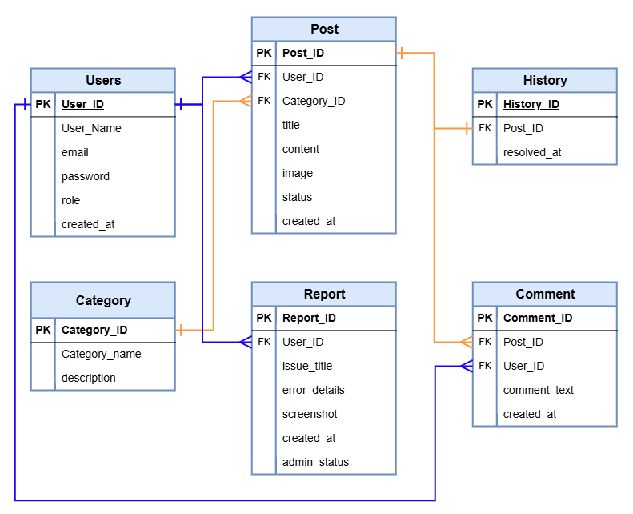
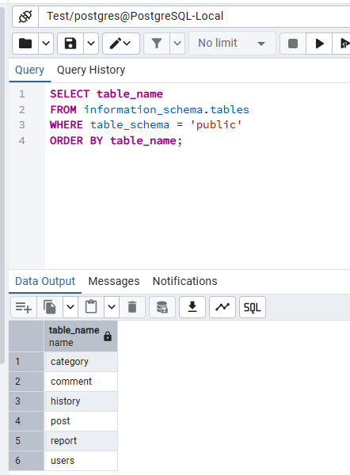
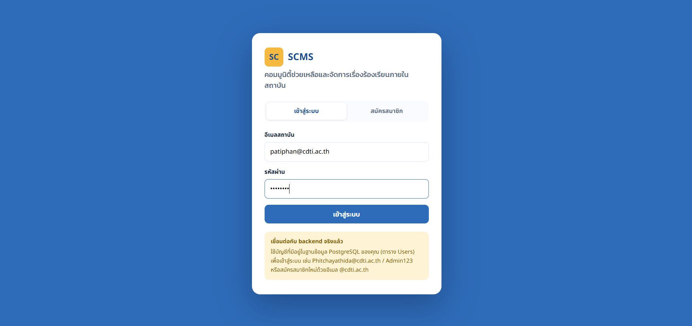
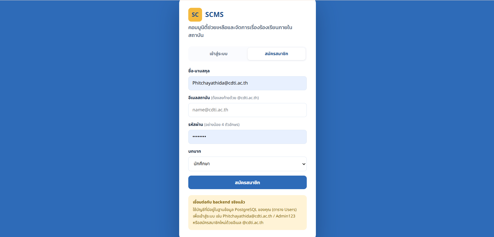
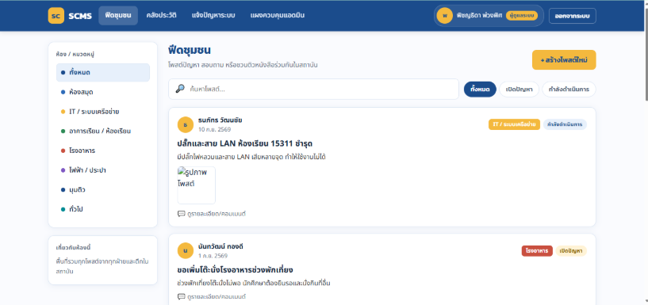
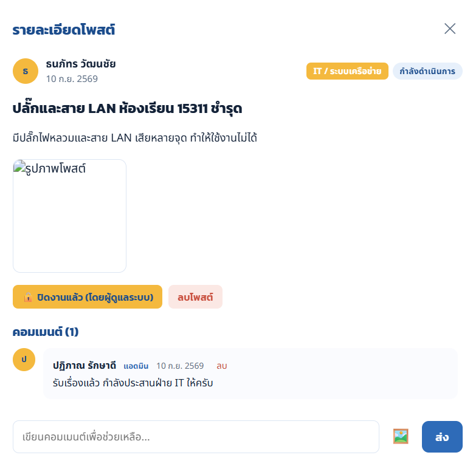
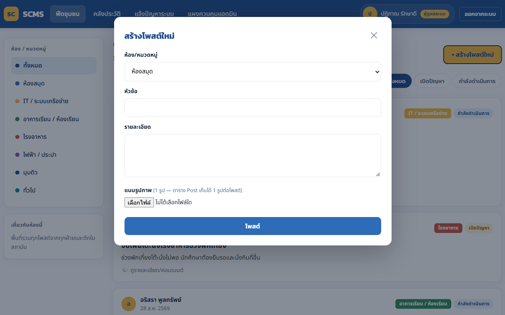
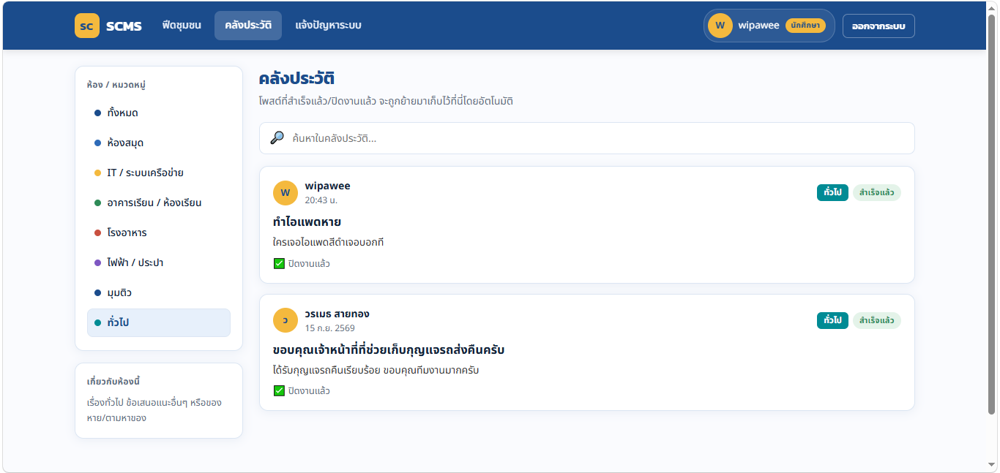
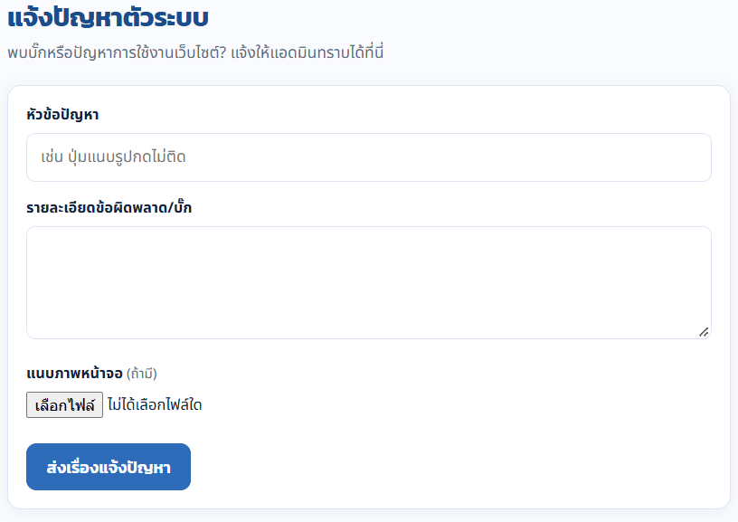
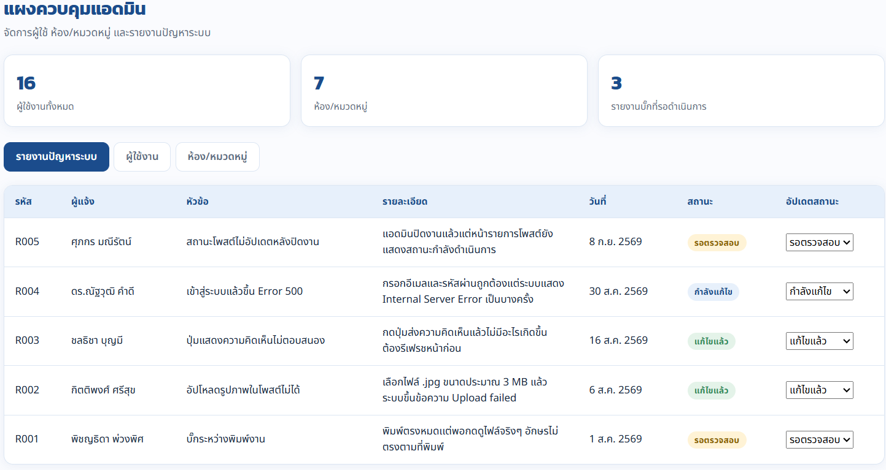

# SCMS · School Community & Grievance Management System

ระบบชุมชนช่วยเหลือและจัดการเรื่องร้องเรียนภายในสถาบัน ผู้ใช้เลือกห้อง/หมวดหมู่ (ห้องสมุด, IT, โรงอาหาร ฯลฯ) แล้วโพสต์ปัญหาพร้อมรูป เจ้าหน้าที่และเพื่อนร่วมสถาบันคอมเมนต์ช่วยเหลือ เจ้าของโพสต์กดปิดปัญหาแล้วโพสต์จะย้ายไปเก็บในคลังประวัติ และผู้ใช้แจ้งบั๊กของระบบถึงแอดมินได้

โครงงาน Mini-DB Project วิชา 310-2209 Business-Driven SQL · ทีม DataSync

เน้นการออกแบบฐานข้อมูล: **PostgreSQL 6 ตาราง** · ENUM 3 ชุด · Foreign Key พร้อมกฎ CASCADE/RESTRICT · Business Queries 4 ข้อ · ฝั่งเว็บใช้ Node.js + Express และ HTML/CSS/JavaScript

## ที่มาและวัตถุประสงค์

**ที่มาและปัญหา** กระบวนการแจ้งปัญหาและจัดการเรื่องร้องเรียนภายในสถาบันยังล่าช้า และขาดพื้นที่ศูนย์กลางที่นักศึกษา อาจารย์ และบุคลากรเข้าถึงร่วมกันได้ ทำให้ผู้แจ้งเรื่องติดตามความคืบหน้าไม่ได้ กระบวนการขาดความโปร่งใส และไม่มีการจัดเก็บประวัติและแนวทางแก้ไขอย่างเป็นระบบ ปัญหาเดิมจึงเกิดซ้ำโดยไม่มีบันทึกการปิดงานที่ชัดเจน

**วัตถุประสงค์**

1. สร้างพื้นที่ส่วนกลางให้นักศึกษา อาจารย์ และผู้ดูแลระบบติดตามสถานะและร่วมกันแก้ไขปัญหา
2. รวบรวมคลังประวัติและวิธีการแก้ปัญหาที่แก้ไขเสร็จสิ้นแล้ว เพื่อป้องกันปัญหาซ้ำและใช้อ้างอิงในอนาคต
3. ส่งเสริมวัฒนธรรมการช่วยเหลือเกื้อกูลกันภายในสถาบัน (Peer-to-Peer Support) ผ่านการแลกเปลี่ยนคำแนะนำและการประสานงานอย่างเป็นระบบ

## ภาพรวมโครงการ

| ER Diagram | Database ใน pgAdmin |
|---|---|
|  |  |

ไฟล์ฐานข้อมูลอยู่ที่ [`database/`](database/): [`database_schema_postgresql2.sql`](database/database_schema_postgresql2.sql) (สร้างตาราง + ข้อมูลตัวอย่าง), [`migration_widen_image_columns.sql`](database/migration_widen_image_columns.sql), [`business_queries.sql`](database/business_queries.sql)

## เริ่มใช้งาน

ต้องมี [Node.js](https://nodejs.org) 18 ขึ้นไป และ PostgreSQL

1. สร้างฐานข้อมูลใน PostgreSQL (เช่น `issue_report_system`) แล้วรันสคริปต์สคีมา (สร้างตารางและใส่ข้อมูลตัวอย่าง)

   ```bash
   psql -U postgres -d issue_report_system -f database/database_schema_postgresql2.sql
   ```

2. ถ้าต้องการเก็บรูปแนบเป็น base64 ให้รันไฟล์ขยายคอลัมน์รูปด้วย (VARCHAR(255) สั้นเกินไป)

   ```bash
   psql -U postgres -d issue_report_system -f database/migration_widen_image_columns.sql
   ```

3. ติดตั้งและตั้งค่า backend

   ```bash
   cd scms-backend
   npm install
   cp .env.example .env     # แล้วแก้ค่าใน .env ให้ตรงกับ PostgreSQL ของเครื่อง
   npm start
   ```

4. เปิด http://localhost:4000 (backend ให้บริการหน้าเว็บจาก `scms-frontend/` ด้วย) ตรวจการเชื่อมต่อฐานข้อมูลที่ http://localhost:4000/api/health

ไฟล์ `.env` เก็บรหัสผ่านฐานข้อมูล **ถูกยกเว้นจาก Git** (`.gitignore`) ให้ใช้ `.env.example` เป็นแม่แบบเท่านั้น

### บัญชีสาธิต (ข้อมูลตัวอย่างในสคีมา)

| บทบาท | อีเมล | รหัสผ่าน |
|---|---|---|
| แอดมิน | Phitchayathida@cdti.ac.th | `Admin123` |

ข้อมูลตัวอย่างมีผู้ใช้ 16 คน (แอดมิน นักศึกษา อาจารย์ บุคลากร) ดูอีเมลและบทบาทได้ในไฟล์สคีมา หรือสมัครสมาชิกใหม่ด้วยอีเมล `@cdti.ac.th` รหัสผ่านเป็นข้อมูลสาธิตเท่านั้น

## ภาพรวมของระบบ

| เข้าสู่ระบบ | สมัครสมาชิก | ฟีดชุมชน |
|---|---|---|
|  |  |  |

| รายละเอียดโพสต์ | สร้างโพสต์ใหม่ | คลังประวัติ |
|---|---|---|
|  |  |  |

| แจ้งปัญหาระบบ | แผงควบคุมแอดมิน |
|---|---|
|  |  |

## ความสามารถของระบบ

| บทบาท | สิ่งที่ทำได้ |
|---|---|
| นักศึกษา | สร้างโพสต์ คอมเมนต์ ปิดโพสต์ของตนเป็น "สำเร็จแล้ว" ลบโพสต์ของตนที่ยังไม่จบ และแจ้งปัญหาระบบ |
| อาจารย์ / บุคลากร | มีสิทธิ์การใช้งานพื้นฐานเช่นเดียวกับนักศึกษา ร่วมตอบ ให้คำปรึกษา และประสานงานแก้ไขปัญหาให้แก่นักศึกษาในโพสต์ต่าง ๆ |
| ผู้ดูแลระบบ (Admin) | ทำได้ทุกอย่างข้างต้น ลบคอมเมนต์ และเปลี่ยนสถานะโพสต์เป็น "กำลังดำเนินการ" หรือ "ปิดงานแล้ว" เข้าแผงควบคุมเพื่อจัดการผู้ใช้ ห้อง/หมวดหมู่ และรายงานปัญหาระบบ |

เมื่อโพสต์เปลี่ยนเป็น "สำเร็จแล้ว" หรือ "ปิดงานแล้ว" backend จะอัปเดตตาราง `Post` และเพิ่มแถวลงตาราง `History` ภายใน Transaction เดียวกัน (`BEGIN … COMMIT/ROLLBACK`) และตรวจก่อนว่ายังไม่มีบันทึกของโพสต์นั้น เพื่อให้ Post–History เป็น 1 ต่อ 1

## แบบจำลองข้อมูล

| ตาราง | PK | FK | หน้าที่ |
|---|---|---|---|
| Users | User_ID | - | บัญชีผู้ใช้ (`email` UNIQUE, `role` เป็น ENUM `user_role`) |
| Category | Category_ID | - | ห้อง/หมวดหมู่ |
| Post | Post_ID (SERIAL) | User_ID, Category_ID | โพสต์ (`status` เป็น ENUM `post_status`) |
| Comment | Comment_ID | Post_ID, User_ID | ความคิดเห็น |
| History | History_ID | Post_ID | คลังประวัติโพสต์ที่จบงานแล้ว |
| Report | Report_ID | User_ID | รายงานปัญหาของระบบถึงแอดมิน (`admin_status` เป็น ENUM `report_status`) |

| ความสัมพันธ์ | ชนิด | ON DELETE |
|---|---|---|
| Users – Post | 1 : N | CASCADE |
| Category – Post | 1 : N | **RESTRICT** (ห้ามลบห้องที่ยังมีโพสต์) |
| Users – Comment | 1 : N | CASCADE |
| Post – Comment | 1 : N | CASCADE |
| Post – History | 1 : 1 | CASCADE |
| Users – Report | 1 : N | CASCADE |

ทุก Foreign Key กำหนด `ON UPDATE CASCADE`

| ENUM | ค่า |
|---|---|
| `user_role` | Admin, นักศึกษา, อาจารย์, บุคลากร |
| `post_status` | เปิด, กำลังดำเนินการ, สำเร็จแล้ว, ปิดงานแล้ว |
| `report_status` | รอตรวจสอบ, กำลังแก้ไข, แก้ไขแล้ว |

### Data Dictionary

**Users**

| คอลัมน์ | ชนิดข้อมูล | คีย์ / ข้อกำหนด | คำอธิบาย |
|---|---|---|---|
| User_ID | VARCHAR(10) | PRIMARY KEY | รหัสผู้ใช้ เช่น U001 |
| User_Name | VARCHAR(100) | NOT NULL | ชื่อสำหรับแสดงผลบนเว็บ |
| email | VARCHAR(150) | NOT NULL, UNIQUE | อีเมลสถาบันสำหรับเข้าสู่ระบบ ห้ามซ้ำ |
| password | VARCHAR(255) | NOT NULL | รหัสผ่านสำหรับยืนยันตัวตน |
| role | user_role | NOT NULL, DEFAULT 'นักศึกษา' | บทบาท/สิทธิ์การใช้งาน |
| created_at | TIMESTAMP | DEFAULT CURRENT_TIMESTAMP | วันเวลาที่สมัคร |

**Category**

| คอลัมน์ | ชนิดข้อมูล | คีย์ / ข้อกำหนด | คำอธิบาย |
|---|---|---|---|
| Category_ID | VARCHAR(10) | PRIMARY KEY | รหัสหมวดหมู่ เช่น C001 |
| Category_name | VARCHAR(100) | NOT NULL | ชื่อหมวดหมู่/ห้อง |
| description | TEXT | - | คำอธิบายขอบเขตของหมวดหมู่ |

**Post**

| คอลัมน์ | ชนิดข้อมูล | คีย์ / ข้อกำหนด | คำอธิบาย |
|---|---|---|---|
| Post_ID | SERIAL | PRIMARY KEY | รหัสโพสต์ เพิ่มค่าอัตโนมัติ |
| User_ID | VARCHAR(10) | FK → Users, NOT NULL | เจ้าของโพสต์ |
| Category_ID | VARCHAR(10) | FK → Category, NOT NULL | หมวดหมู่ของโพสต์ |
| title | VARCHAR(255) | NOT NULL | หัวข้อโพสต์ |
| content | TEXT | - | รายละเอียดโพสต์ |
| image | VARCHAR(255) | - | รูปแนบ (เว้นว่างได้; ขยายเป็น TEXT ด้วย migration) |
| status | post_status | NOT NULL, DEFAULT 'เปิด' | สถานะโพสต์ |
| created_at | TIMESTAMP | DEFAULT CURRENT_TIMESTAMP | วันเวลาที่สร้างโพสต์ |

**Comment**

| คอลัมน์ | ชนิดข้อมูล | คีย์ / ข้อกำหนด | คำอธิบาย |
|---|---|---|---|
| Comment_ID | VARCHAR(10) | PRIMARY KEY | รหัสความคิดเห็น เช่น CM001 |
| Post_ID | INT | FK → Post, NOT NULL | โพสต์ที่ถูกตอบ |
| User_ID | VARCHAR(10) | FK → Users, NOT NULL | ผู้แสดงความคิดเห็น |
| comment_text | TEXT | NOT NULL | ข้อความ |
| created_at | TIMESTAMP | DEFAULT CURRENT_TIMESTAMP | วันเวลาที่ส่ง |

**History**

| คอลัมน์ | ชนิดข้อมูล | คีย์ / ข้อกำหนด | คำอธิบาย |
|---|---|---|---|
| History_ID | VARCHAR(10) | PRIMARY KEY | รหัสประวัติ เช่น H001 |
| Post_ID | INT | FK → Post, NOT NULL | โพสต์ที่จบงาน (1 โพสต์ต่อ 1 รายการ ควบคุมโดย backend) |
| resolved_at | TIMESTAMP | DEFAULT CURRENT_TIMESTAMP | วันเวลาที่แก้ไขเสร็จ |

**Report**

| คอลัมน์ | ชนิดข้อมูล | คีย์ / ข้อกำหนด | คำอธิบาย |
|---|---|---|---|
| Report_ID | VARCHAR(10) | PRIMARY KEY | รหัสรายงาน เช่น R001 |
| User_ID | VARCHAR(10) | FK → Users, NOT NULL | ผู้แจ้งปัญหา |
| issue_title | VARCHAR(255) | NOT NULL | หัวข้อปัญหา |
| error_details | TEXT | - | รายละเอียดข้อผิดพลาด |
| screenshot | VARCHAR(255) | - | ภาพหน้าจอประกอบ (ขยายเป็น TEXT ด้วย migration) |
| created_at | TIMESTAMP | DEFAULT CURRENT_TIMESTAMP | วันเวลาที่แจ้ง |
| admin_status | report_status | NOT NULL, DEFAULT 'รอตรวจสอบ' | สถานะการจัดการของแอดมิน |

### ข้อมูลตัวอย่าง (Sample Data)

| ตาราง | จำนวนแถว | รายละเอียด |
|---|---|---|
| Users | 16 | Admin 2, อาจารย์ 2, บุคลากร 3, นักศึกษา 9 |
| Category | 7 | ห้องสมุด, IT / ระบบเครือข่าย, อาคารเรียน / ห้องเรียน, โรงอาหาร, ไฟฟ้า / ประปา, มุมติว, ทั่วไป |
| Post | 15 | กระจายครบทุกหมวดหมู่และทุกสถานะ |
| Comment | 14 | กระจายอยู่ใน 12 โพสต์ |
| History | 7 | เฉพาะโพสต์ที่ "สำเร็จแล้ว" หรือ "ปิดงานแล้ว" (Post_ID 1, 3, 5, 8, 12, 13, 15) |
| Report | 5 | ครบทั้ง 3 สถานะ |

เนื่องจาก `Post_ID` เป็น SERIAL แต่ข้อมูลตัวอย่างระบุค่า 1–15 ลงไปตรง ๆ สคริปต์จึงรีเซ็ต Sequence เพื่อให้โพสต์ใหม่เริ่มที่ 16 ป้องกัน Duplicate Key Error

```sql
SELECT setval(pg_get_serial_sequence('Post', 'post_id'), (SELECT MAX(Post_ID) FROM Post));
```

## Business Queries

คำสั่งทั้งหมดอยู่ใน [`database/business_queries.sql`](database/business_queries.sql) ผลลัพธ์ด้านล่างมาจากการรันบนข้อมูลตัวอย่างในสคีมา

### Query 1: จำนวนโพสต์และอัตราการจบงานแยกตามห้อง/หมวดหมู่

**โจทย์ธุรกิจ:** ฝ่ายที่ดูแลระบบต้องการรู้ว่าห้องไหนมีเรื่องเข้ามามากและจบงานได้สัดส่วนเท่าไร ใช้ LEFT JOIN จาก Category เพื่อให้ทุกห้องปรากฏแม้ยังไม่มีโพสต์ และใช้ NULLIF ป้องกันการหารด้วยศูนย์

```sql
SELECT c.category_name,
       COUNT(p.post_id)     AS total_posts,
       COUNT(h.history_id)  AS resolved_posts,
       ROUND(100.0 * COUNT(h.history_id) / NULLIF(COUNT(p.post_id), 0), 1) AS resolved_pct
FROM Category c
LEFT JOIN Post p    ON p.category_id = c.category_id
LEFT JOIN History h ON h.post_id = p.post_id
GROUP BY c.category_id, c.category_name
ORDER BY total_posts DESC, c.category_id;
```

ผลลัพธ์จากข้อมูลตัวอย่าง

| category_name | total_posts | resolved_posts | resolved_pct |
|---|---|---|---|
| IT / ระบบเครือข่าย | 3 | 1 | 33.3 |
| ห้องสมุด | 2 | 1 | 50.0 |
| อาคารเรียน / ห้องเรียน | 2 | 1 | 50.0 |
| โรงอาหาร | 2 | 1 | 50.0 |
| ไฟฟ้า / ประปา | 2 | 1 | 50.0 |
| มุมติว | 2 | 1 | 50.0 |
| ทั่วไป | 2 | 1 | 50.0 |

### Query 2: เวลาเฉลี่ยที่ใช้แก้ปัญหา (ชั่วโมง) แยกตามห้อง/หมวดหมู่

**โจทย์ธุรกิจ:** วัดประสิทธิภาพการแก้ปัญหาของแต่ละฝ่าย หาผลต่างเวลา `resolved_at - created_at` แปลงเป็นชั่วโมงด้วย `EXTRACT(EPOCH ...)/3600` ในข้อมูลตัวอย่างแต่ละหมวดมีโพสต์ที่จบงาน 1 รายการ ค่าเฉลี่ยจึงเท่ากับเวลาจริงของโพสต์นั้น

```sql
SELECT c.category_name,
       COUNT(*) AS resolved_posts,
       ROUND(AVG(EXTRACT(EPOCH FROM (h.resolved_at - p.created_at)) / 3600)::numeric, 1) AS avg_hours
FROM History h
JOIN Post p     ON p.post_id = h.post_id
JOIN Category c ON c.category_id = p.category_id
GROUP BY c.category_name
ORDER BY avg_hours DESC;
```

ผลลัพธ์จากข้อมูลตัวอย่าง

| category_name | resolved_posts | avg_hours |
|---|---|---|
| อาคารเรียน / ห้องเรียน | 1 | 78.8 |
| โรงอาหาร | 1 | 48.8 |
| ไฟฟ้า / ประปา | 1 | 25.5 |
| ห้องสมุด | 1 | 19.7 |
| ทั่วไป | 1 | 10.8 |
| มุมติว | 1 | 3.0 |
| IT / ระบบเครือข่าย | 1 | 2.9 |

### Query 3: โพสต์ที่ยังค้างและยังไม่มีคอมเมนต์ตอบกลับ

**โจทย์ธุรกิจ:** หาเรื่องที่ยังไม่มีใครรับเรื่อง เพื่อติดตามเป็นลำดับแรก ใช้ LEFT JOIN กับ Comment แล้วกรองด้วย `HAVING COUNT(m.comment_id) = 0` เรียงจากเก่าไปใหม่

```sql
SELECT p.post_id, p.title, c.category_name, p.status, p.created_at::date AS created_date
FROM Post p
JOIN Category c     ON c.category_id = p.category_id
LEFT JOIN Comment m ON m.post_id = p.post_id
WHERE p.status IN ('เปิด', 'กำลังดำเนินการ')
GROUP BY p.post_id, p.title, c.category_name, p.status, p.created_at
HAVING COUNT(m.comment_id) = 0
ORDER BY p.created_at;
```

ผลลัพธ์จากข้อมูลตัวอย่าง

| post_id | title | category_name | status | created_date |
|---|---|---|---|---|
| 9 | ลืมกระเป๋าดินสอไว้ที่ตึก 604 โต๊ะม้าหินอ่อน | ทั่วไป | เปิด | 2026-08-25 |
| 11 | ขอเพิ่มโต๊ะนั่งโรงอาหารช่วงพักเที่ยง | โรงอาหาร | เปิด | 2026-09-01 |

### Query 4: ตรวจสอบรายชื่อตารางทั้งหมดในฐานข้อมูล

**โจทย์ธุรกิจ:** ต้องการตรวจสอบว่ามีตารางอะไรบ้างในระบบฐานข้อมูล

```sql
SELECT table_name
FROM information_schema.tables
WHERE table_schema = 'public'
ORDER BY table_name;
```

ผลลัพธ์: `category`, `comment`, `history`, `post`, `report`, `users` (ครบ 6 ตาราง)

### Query เพิ่มเติม (ไม่ได้อยู่ในรายงาน)

ไฟล์ `business_queries.sql` มีอีก 2 ข้อสำหรับใช้ทดลอง

**ผู้ใช้ที่มีส่วนร่วมสูงสุด 5 อันดับ (โพสต์ + คอมเมนต์)**

```sql
SELECT u.user_name, u.role,
       COALESCE(pc.posts, 0)    AS posts,
       COALESCE(cc.comments, 0) AS comments,
       COALESCE(pc.posts, 0) + COALESCE(cc.comments, 0) AS activity
FROM Users u
LEFT JOIN (SELECT user_id, COUNT(*) AS posts    FROM Post    GROUP BY user_id) pc ON pc.user_id = u.user_id
LEFT JOIN (SELECT user_id, COUNT(*) AS comments FROM Comment GROUP BY user_id) cc ON cc.user_id = u.user_id
ORDER BY activity DESC, u.user_id
LIMIT 5;
```

**จำนวนรายงานปัญหาระบบแยกตามสถานะ**

```sql
SELECT admin_status, COUNT(*) AS total_reports
FROM Report
GROUP BY admin_status
ORDER BY total_reports DESC;
```

## REST API

Backend แปลงชื่อฟิลด์และค่า ENUM ภาษาไทยในฐานข้อมูล (`นักศึกษา`, `เปิด`) เป็นรูปแบบที่หน้าเว็บใช้ (`student`, `open`) ดูรายละเอียดที่ [`scms-backend/helpers.js`](scms-backend/helpers.js)

| Method | Endpoint | คำอธิบาย |
|---|---|---|
| GET | `/api/health` | ตรวจการเชื่อมต่อฐานข้อมูล |
| POST | `/api/auth/login` | เข้าสู่ระบบ `{email, password}` |
| POST | `/api/auth/register` | สมัครสมาชิก `{name, email, password, role}` |
| GET / POST | `/api/categories` | ดู / เพิ่มห้อง/หมวดหมู่ |
| DELETE | `/api/categories/:id` | ลบห้อง |
| GET | `/api/posts?status=&roomId=&search=` | รายการโพสต์ (`status`: `open`, `in_progress`, `resolved`, `closed`, `all`, `archive`) |
| GET | `/api/posts/:id` | รายละเอียดโพสต์ |
| POST | `/api/posts` | สร้างโพสต์ |
| PATCH | `/api/posts/:id/status` | เปลี่ยนสถานะ (`resolved`/`closed` เพิ่มแถวใน History อัตโนมัติ) |
| DELETE | `/api/posts/:id` | ลบโพสต์ |
| GET / POST | `/api/comments` | ดู / เพิ่มคอมเมนต์ |
| GET / POST | `/api/reports` | ดู / แจ้งปัญหาระบบ |
| PATCH | `/api/reports/:id` | อัปเดตสถานะรายงาน |
| GET | `/api/users` | รายชื่อผู้ใช้ (แอดมิน) |
| PATCH / DELETE | `/api/users/:id` | เปลี่ยนบทบาท / ลบผู้ใช้ |

## โครงสร้างโครงการ

```text
.
├── database/
│   ├── database_schema_postgresql2.sql   # ENUM + 6 ตาราง + ข้อมูลตัวอย่าง
│   ├── migration_widen_image_columns.sql # ขยายคอลัมน์รูปเป็น TEXT
│   ├── business_queries.sql              # Business Queries (4 ข้อในรายงาน + 2 ข้อเพิ่มเติม)
│   └── ER_Diagram.png
├── scms-backend/                         # Express API (db.js, helpers.js, routes/)
├── scms-frontend/scms-src/               # หน้าเว็บ (index.html, app.js, api.js, style.css)
└── Image/                                # ภาพหน้าจอและ ER Diagram
```

## ทีมผู้จัดทำ

ทีม DataSync · วิชา 310-2209 Business-Driven SQL · คณะเทคโนโลยีดิจิทัล สาขาวิศวกรรมคอมพิวเตอร์ สถาบันเทคโนโลยีจิตรลดา

| บทบาท | รหัสนักศึกษา | ชื่อ-นามสกุล | หน้าที่ |
|---|---|---|---|
| หัวหน้าทีม | 6810301011 | นางสาว ศุภนาถ ปิ๋วสวัสดิ์ | Frontend |
| สมาชิก | 6810301007 | นางสาว วิภาวี พรมสุข | Presentation/Report |
| สมาชิก | 6810301014 | นาย สายชล ยอยโพธิ์สัย | Backend/Database |
| สมาชิก | 6810301015 | นาย ปฏิภาณ รักษาดี | Backend/Database |
| สมาชิก | 6810301016 | นางสาว พิชญธิดา พ่วงพิศ | ERD/โครงสร้างฐานข้อมูลหลังบ้าน |
| สมาชิก | 6810301021 | นาย สิทธิภัทร คำบุญมา | Backend/Database |

อาจารย์ผู้สอน: รองศาสตราจารย์ ดร.อานนท์ รุ่งสว่าง
